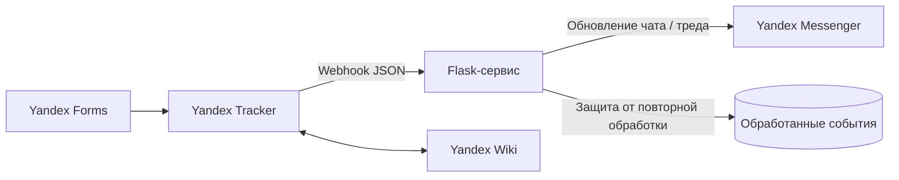

# Mitlex: автоматизация операционных процессов

> Обезличенный портфельный кейс по цифровой модернизации внутренних процессов строительной компании. В репозитории — требования, архитектура и запускаемый пример; production-код, учётные данные и данные компании исключены.

  

## Ситуация и задача

### Контекст

Заявки на снабжение, согласование счетов, оплату и контроль поставки координировались через чаты, таблицы и личные сообщения. На стыках процессов терялись файлы, статусы и ответственность; сотрудникам было трудно быстро понять, что происходит с задачей.

### Задача

Собрать единый контур учёта задач и сохранить удобный мобильный способ получать их контекст и обновления.

### Ограничения

- Решение должно было работать с разным уровнем цифровой зрелости сотрудников.
- Yandex Tracker должен был остаться единым источником статуса, а мессенджер — каналом уведомлений, а не второй системой учёта.

### Критерий успеха

Задача проходит по формализованному маршруту с ответственным, статусом и сроком; ключевые обновления приходят в нужный чат или тред без ручной пересылки.

## Диагностика AS-IS

Я описал роли, ручные операции, риски и точки передачи информации. Приоритетными стали контуры снабжения, согласования счёта, оплаты, контроля поставки и административных заявок.

Главные проблемы:

- нет единого места, где видны статус и ответственный;
- контекст задачи и вложения остаются в разных чатах;
- обновления приходится вручную пересылать между участниками процесса;
- без понятного маршрута сложно контролировать прохождение заявки между подразделениями.

## Целевая модель и решение

Целевая модель сделала **Yandex Tracker** единым источником статуса: формы собирают структурированные заявки, маршруты и триггеры проводят их по процессу, а Flask-сервис получает webhook-события и отправляет краткие обновления в нужный чат или тред **Yandex Messenger**.



## Моя роль

1. Провёл AS-IS / TO-BE-анализ: роли, статусы, маршруты, user stories, критерии приёмки и бизнес-правила.
2. Спроектировал процессные цепочки в Yandex Tracker: типы заявок, локальные поля, доски, триггеры и правила передачи задач.
3. Реализовал интеграцию на Python/Flask: приём webhook-событий, разбор JSON, обработка статусов и вложений, маршрутизация сообщений в Yandex Messenger.
4. Провёл end-to-end-проверки в тестовом контуре и подготовил rollout и операционные инструкции.

## Реализованные сценарии

В боевой очереди OPS настроены три процессные цепочки:

1. Снабжение → Финансы → Бухгалтерия.
2. Администрация → Финансы → Бухгалтерия.
3. Инициатор → Финансы → Бухгалтерия.

Для них предусмотрен связанный контур контроля поставки. Уведомления по проектным задачам идут в треде: корневое сообщение создаёт контекст, а дальнейшие изменения статуса и вложения приходят в тот же тред.

## Результат для бизнеса

- Процессные заявки получили единый маршрут, статусы, ответственных и правила работы с документами.
- Сотрудники получают контекст задачи и её обновления в привычном мессенджере, не теряя Tracker как источник учёта.
- Production-сервис `tracker-webhooks.service` прошёл проверку; smoke-тест сообщений в шесть проектных чатов вернул HTTP 200.
- Реализован endpoint синхронизации досок отделов и проектов для задач очереди OPS.

## Артефакты

| Материал | Что внутри |
| --- | --- |
| [Требования](docs/REQUIREMENTS.md) | User stories, критерии приёмки и бизнес-правила |
| [TO-BE-процесс](docs/PROCESS_MODEL.md) | Сквозной BPMN-сценарий: инициатор → снабжение → финансы → бухгалтерия → контроль поставки |
| [Архитектура](docs/ARCHITECTURE.md) | Компоненты, поток данных, надёжность и границы системы |
| [Webhook API](docs/API_CONTRACT.md) | Контракт и обезличенные payloads |
| [Стратегия тестирования](docs/TEST_STRATEGY.md) | Сквозные и приёмочные сценарии |
| [Риски](docs/RISKS.md) | Операционные, интеграционные и организационные риски |
| [`src/`](src) и [`tests/`](tests) | Запускаемый Flask-пример и pytest-проверки |

## Быстрый запуск примера

```bash
python -m venv .venv
source .venv/bin/activate
pip install -r requirements-dev.txt
cp .env.example .env
set -a && source .env && set +a
pytest
PYTHONPATH=src flask --app tracker_bridge.app run --debug
```

## Стек

`Yandex Tracker` · `Yandex Forms` · `Yandex Messenger` · `Yandex Wiki` · `Python` · `Flask` · `Webhooks` · `JSON` · `pytest` · `BPMN` · `AS-IS / TO-BE`
